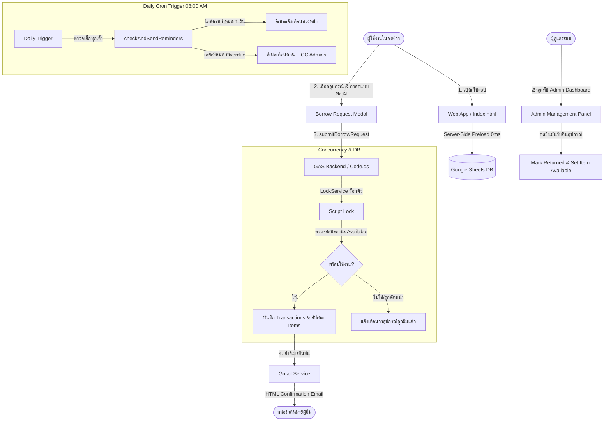

# ระบบยืม-คืนอุปกรณ์ภายในองค์กร (Google Workspace Equipment Borrowing & Return System)

[](https://developers.google.com/apps-script)
[](https://www.google.com/sheets/about/)
[](https://tailwindcss.com/)
[](https://fontawesome.com/)
[](https://opensource.org/licenses/MIT)

ระบบยืม-คืนอุปกรณ์และทรัพย์สินส่วนกลางภายในองค์กรแบบครบวงจร (Full-Stack Serverless) พัฒนาบนสถาปัตยกรรม **Google Workspace Stack** ใช้งานฟรี 100% ไม่ต้องเช่า Server หรือ Cloud Database เพิ่มเติม

---

## 🌟 จุดเด่นและฟีเจอร์หลัก (Key Features)

- ⚡ **Server-Side Preload (โหลดไวใน 0 วินาที)**: ฝังข้อมูลเริ่มต้นจาก Google Sheets ลงในโครงสร้าง HTML ตั้งแต่ฝั่งเซิร์ฟเวอร์ (`doGet`) หน้าเว็บเปิดได้ทันทีโดยไม่ต้องรอดาวน์โหลดผ่าน Client-side API และแก้ปัญหา Multi-Google Account ขัดแย้งกันอย่างสมบูรณ์
- 🔒 **Concurrency Control (ป้องกันการยืมชนกัน)**: ใช้ `LockService` ของ Google Apps Script ล็อกสคริปต์ระดับมิลลิวินาที ป้องกันกรณีผู้ใช้งานหลายคนกดขอยืมอุปกรณ์ชิ้นเดียวกันในเสี้ยววินาทีเดียวกัน
- 📱 **Modern & Responsive UI**: พัฒนาด้วย Tailwind CSS, FontAwesome 6, SweetAlert2 และฟอนต์ภาษาไทย Prompt รองรับการใช้งานทั้งบนมือถือ แท็บเล็ต และคอมพิวเตอร์อย่างลื่นไหล
- 🔍 **ค้นหาและคัดกรองทันใจ (Live Filter & Search)**: ค้นหาตามชื่ออุปกรณ์, รหัสทรัพย์สิน, Serial Number พร้อมปุ่ม Filter หมวดหมู่ และสวิตช์เปิดดูเฉพาะอุปกรณ์ที่พร้อมใช้งาน
- 🏢 **รองรับโครงสร้างฝ่ายงาน 22 แผนก**: แบบฟอร์มขอยืมอุปกรณ์มีเมนูเลือกแผนกตามโครงสร้างองค์กร (01 GA ถึง 22 LINC) ครบถ้วน
- 📧 **ระบบแจ้งเตือนทางอีเมลอัตโนมัติ (Gmail Notifications)**:
  - ส่งอีเมลยืนยันการยืม (HTML Card สวยงาม พร้อม QR/Transaction ID, รายละเอียดอุปกรณ์, กำหนดส่งคืน และข้อควรระวัง)
  - ระบบ Time-driven Trigger ทำงานอัตโนมัติทุกเช้า 08:00 น. เพื่อส่งอีเมลเตือนก่อนครบกำหนด 1 วัน และแจ้งเตือนด่วนกรณีเลยกำหนดส่งคืน (Overdue) พร้อม CC ผู้ดูแลระบบ
- 🛡️ **Admin Dashboard ในตัว (Role-Based Access Control)**:
  - ตรวจสอบสิทธิ์ Admin จากอีเมลผู้ล็อกอินเทียบกับชีต `Settings`
  - สรุปสถิติอุปกรณ์ทั้งหมด, ถูกยืม, เกินกำหนด และอยู่ระหว่างซ่อมบำรุง
  - ตารางประวัติและปุ่มกดบันทึกรับคืนอุปกรณ์ (พร้อมบันทึกสภาพอุปกรณ์และปรับสถานะคืนชีต `Items` อัตโนมัติ)
  - จัดการข้อมูลอุปกรณ์ (เพิ่ม / แก้ไข / ปรับสถานะซ่อมบำรุง)
  - ติดตั้ง/ถอนการติดตั้ง Time-driven Trigger ได้ในคลิกเดียวผ่านหน้าเว็บ

---

## 🏗️ แผนผังการทำงานของระบบ (System Workflow)



---

## 📁 โครงสร้างโปรเจกต์ (Project Structure)

```
Google-Workspace-Equipment-Borrowing-System/
├── Code.gs          # Backend GAS: ฐานข้อมูล, API, LockService, จัดการอีเมล, Admin Functions & Triggers
├── Index.html       # Frontend: Tailwind CSS, FontAwesome 6, Modals, State Store, Admin Panel
├── .gitignore       # Git ignore file
└── README.md        # เอกสารและคู่มือการติดตั้งใช้งาน
```

---

## 🗄️ โครงสร้างฐานข้อมูล (Database Schema in Google Sheets)

ระบบจะสร้างชีตให้อัตโนมัติเมื่อรันฟังก์ชัน `initDatabase` โดยประกอบด้วย 3 ชีตหลัก:

### 1. ชีต `Items` (ตารางอุปกรณ์)
| คอลัมน์ | รายละเอียด | ตัวอย่าง |
|---|---|---|
| A: `Item_ID` | รหัสอ้างอิงอุปกรณ์ | `IT-001` |
| B: `Name` | ชื่ออุปกรณ์ | `MacBook Pro 14" (M3 Pro)` |
| C: `Category` | หมวดหมู่ | `คอมพิวเตอร์และโน้ตบุ๊ก` |
| D: `Serial_Number` | ซีเรียลนัมเบอร์ | `SN-MBP14-202401` |
| E: `Status` | สถานะ (`Available`, `Borrowed`, `Maintenance`)| `Available` |
| F: `Location` | สถานที่จัดเก็บ | `ตู้เก็บอุปกรณ์ IT ชั้น 2` |
| G: `Image_URL` | ลิงก์รูปภาพอุปกรณ์ | `https://images.unsplash.com/...` |
| H: `Specs` | คุณสมบัติ/รายละเอียดเพิ่มเติม | `RAM 18GB, SSD 512GB` |
| I: `Current_Borrower` | อีเมลผู้ยืมปัจจุบัน | `user@company.com` |
| J: `Expected_Return` | กำหนดวันคืนปัจจุบัน | `2026-11-10` |

### 2. ชีต `Transactions` (ตารางบันทึกการยืม-คืน)
| คอลัมน์ | รายละเอียด |
|---|---|
| A: `Transaction_ID` | รหัสอ้างอิงรายการ เช่น `TX-20261104-XXXX` |
| B: `Item_ID` | รหัสอุปกรณ์ |
| C: `Item_Name` | ชื่ออุปกรณ์ |
| D: `Borrower_Name` | ชื่อ-นามสกุล ผู้ยืม |
| E: `Borrower_Email` | อีเมลผู้ยืม |
| F: `Department` | แผนก/ฝ่าย (01 GA - 22 LINC) |
| G: `Borrow_Date` | วันที่ทำรายการยืม |
| H: `Expected_Return_Date` | วันที่กำหนดส่งคืน |
| I: `Actual_Return_Date` | วันที่ส่งคืนจริง |
| J: `Borrow_Type` | ประเภทการยืม (ในสำนักงาน / ออกนอกสถานที่) |
| K: `Purpose` | วัตถุประสงค์การใช้งาน |
| L: `Status` | สถานะรายการ (`Active`, `Returned`, `Overdue`) |
| M: `Notes` | หมายเหตุ / สภาพอุปกรณ์ตอนรับคืน |

### 3. ชีต `Settings` (ตารางตั้งค่าระบบ)
| คอลัมน์ | รายละเอียด | ตัวอย่าง |
|---|---|---|
| `Setting_Key` | คีย์ของการตั้งค่า | `Admin_Emails`, `Reminder_Days_Before`, `Org_Name` |
| `Setting_Value`| ค่าที่กำหนด | `admin@step.cmu.ac.th`, `1`, `STeP CMU` |

---

## 🚀 ขั้นตอนการติดตั้งและเริ่มต้นใช้งาน (Installation Guide)

### ขั้นตอนที่ 1: สร้าง Google Sheets & เปิด Apps Script
1. ไปที่ [Google Sheets](https://sheets.new) เพื่อสร้างสเปรดชีตใหม่
2. ตั้งชื่อสเปรดชีตตามต้องการ เช่น `ระบบยืม-คืนอุปกรณ์ส่วนกลาง`
3. ที่แถบเมนูด้านบน เลือก **ส่วนขยาย (Extensions)** > **Apps Script**

### ขั้นตอนที่ 2: วางโค้ด Backend (`Code.gs`)
1. ในหน้าแก้ไข Apps Script เปิดไฟล์ `Code.gs`
2. ลบโค้ดเดิมออกทั้งหมด แล้วคัดลอกโค้ดจากไฟล์ [`Code.gs`](./Code.gs) ในโปรเจกต์นี้ไปวางแทนที่
3. กดบันทึก (`Ctrl + S` หรือ `Cmd + S`)

### ขั้นตอนที่ 3: สร้างไฟล์หน้าเว็บ (`Index.html`)
1. ที่แถบเมนูด้านซ้าย ในส่วน **ไฟล์ (Files)** ให้คลิกเครื่องหมายบวก `+` > เลือก **HTML**
2. ตั้งชื่อไฟล์ว่า `Index` (ระบบจะใส่ `.html` ให้อัตโนมัติ)
3. ลบโค้ดเริ่มต้นออก แล้วคัดลอกโค้ดจากไฟล์ [`Index.html`](./Index.html) ไปวางแทนที่
4. กดบันทึก (`Ctrl + S` หรือ `Cmd + S`)

### ขั้นตอนที่ 4: รันคำสั่งสร้างฐานข้อมูลครั้งแรก (`initDatabase`)
1. ที่แถบเครื่องมือด้านบน เลือกฟังก์ชัน `initDatabase` จากกล่อง Dropdown
2. คลิกปุ่ม **เรียกใช้ (Run)**
3. จะมีหน้าต่างขอสิทธิ์การเข้าถึงข้อมูล (Authorization Required):
   - คลิก **ตรวจสอบสิทธิ์ (Review Permissions)**
   - เลือกบัญชี Google ของท่าน
   - หากมีข้อความเตือนความปลอดภัย ให้คลิก **ขั้นสูง (Advanced)** > คลิก **ไปยัง... (ไม่ปลอดภัย) / Go to ... (unsafe)**
   - คลิก **อนุญาต (Allow)**
4. เมื่อรันสำเร็จ ให้กลับไปดูที่ Google Sheets จะพบว่าชีตทั้ง 3 แท็บถูกสร้างขึ้นพร้อมข้อมูลตัวอย่างเรียบร้อยแล้ว
5. 💡 **แนะนำ**: ในชีต `Settings` ให้เปลี่ยนค่าในแถว `Admin_Emails` เป็นอีเมลของท่านเพื่อให้ได้รับสิทธิ์ผู้ดูแลระบบ

### ขั้นตอนที่ 5: เผยแพร่เว็บแอป (Deploy Web App)
1. ในหน้าต่าง Apps Script ให้คลิกปุ่ม **การทำให้ใช้งานได้ (Deploy)** ที่มุมขวาบน > เลือก **การทำให้ใช้งานได้รายการใหม่ (New deployment)**
2. คลิกรูปเฟือง ⚙️ ด้านซ้าย > เลือก **เว็บแอป (Web app)**
3. ตั้งค่าการเผยแพร่:
   - **คำอธิบาย (Description)**: `v1.0 Production`
   - **ดำเนินการในฐานะ (Execute as)**: `ฉัน (Me - อีเมลของคุณ)` *(จำเป็นสำหรับการส่งอีเมลแจ้งเตือนและการเข้าถึงชีต)*
   - **ผู้ที่มีสิทธิ์เข้าถึง (Who has access)**: 
     - เลือก `ทุกคนในองค์กร (Everyone in your organization)` สำหรับการใช้งานภายในหน่วยงาน
     - หรือเลือก `ทุกคน (Anyone)`
4. คลิก **ทำให้ใช้งานได้ (Deploy)**
5. คัดลอก **URL เว็บแอป (Web App URL)** นำไปใช้งานหรือส่งให้สมาชิกในองค์กรได้ทันที

### ขั้นตอนที่ 6: เปิดระบบเตือนอัตโนมัติประจำวัน (Time-Driven Trigger)
สามารถเปิดได้ง่ายๆ 2 ช่องทาง:
1. **ผ่านหน้าเว็บ Admin**: เปิด Web App URL > เข้าแท็บ **จัดการระบบ (Admin)** > แท็บย่อย **ระบบแจ้งเตือน & Trigger** > คลิกปุ่ม **"ติดตั้ง Time-driven Trigger (รันทุกวัน 08:00 น.)"**
2. **ผ่าน Apps Script Editor**: เมนูด้านซ้ายรูปนาฬิกาปลุก **ทริกเกอร์ (Triggers)** > **+ เพิ่มทริกเกอร์** > เลือกฟังก์ชัน `checkAndSendReminders` > เหตุการณ์: `ตามเวลา (Time-driven)` > ตัวจับเวลาแบบวัน > ช่วงเวลา `08:00 ถึง 09:00 น.`

---

## 🏢 รายชื่อฝ่ายงานที่รองรับในระบบ (22 ฝ่ายงาน)

แบบฟอร์มการยืมได้กำหนดตัวเลือกฝ่ายงานตามโครงสร้างองค์กรไว้เรียบร้อยแล้ว:
```
01 GA        02 AFP       03 IASA      04 QS        05 NMCO
06 HD        07 PITI      08 TechSpin  09 PUBSEC    10 TechUp
11 EIC       12 ISI       13 CRM       14 IFU       15 IQI
16 LES       17 Foodfabr  18 CC        19 IMO       20 SIT
21 MI        22 LINC      อื่น ๆ
```

---

## 🛠️ เทคโนโลยีที่ใช้ (Tech Stack)

- **Backend**: Google Apps Script (V8 Runtime)
- **Database**: Google Sheets API
- **Mail Service**: GmailApp API (HTML Responsive Email Template)
- **Styling**: Tailwind CSS CDN
- **Icons**: FontAwesome 6 Free Solid CSS
- **Alert & Dialogs**: SweetAlert2
- **Typography**: Google Fonts (Prompt)

---

## 📄 ใบอนุญาต (License)

โปรเจกต์นี้เผยแพร่ภายใต้สัญญาอนุญาต [MIT License](./LICENSE) สามารถนำไปใช้งาน พัฒนาต่อยอด หรือดัดแปลงสำหรับองค์กรได้อย่างอิสระ
